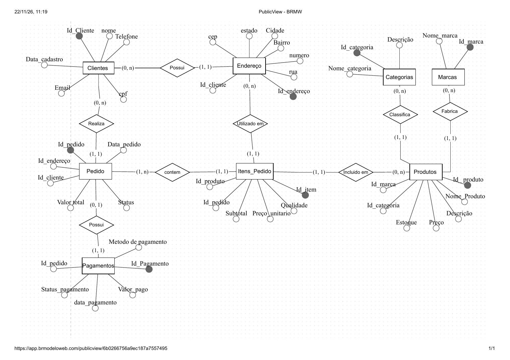

# KaTchau Games

Loja virtual fictícia de games, consoles e periféricos, desenvolvida como projeto acadêmico. O site é feito com HTML5, CSS3 e JavaScript puro.

## Funcionalidades

- Catálogo com 36 produtos em três departamentos: consoles, jogos e periféricos.
- Pesquisa sem distinção de acentos, filtros (categoria, plataforma e faixa de preço), ordenação e chips de filtros ativos.
- Estado dos filtros na URL, o que permite compartilhar o link de uma busca.
- Página de produto com avaliações demonstrativas.
- Carrinho salvo no navegador, com quantidades, remoção, resumo, descontos e parcelamento.
- Cadastro e login (`conta.html`), com conta salva no banco quando o site está publicado; edição de nome e senha.
- Carrinho que acompanha a conta e funciona em qualquer aparelho.
- Finalização de pedido (endereço salvo para as próximas compras e forma de pagamento simulada) e histórico em "Meus pedidos".
- Proteção contra tentativas repetidas de login.
- Atendimento, perguntas frequentes e página institucional.
- Layout responsivo e navegação por teclado.

## Como executar

1. Clone o repositório ou baixe o código.
2. Abra a pasta no Visual Studio Code.
3. Abra `public/index.html` no navegador ou use a extensão **Live Server** (clique direito em `public/index.html`).

Sem a API, o site roda em **modo local**: catálogo, filtros, carrinho e uma conta demonstrativa guardada no navegador. Com o banco configurado, a conta e os pedidos passam a ser gravados no Neon. Veja [`docs/banco-de-dados.md`](docs/banco-de-dados.md).

As fontes vêm do Google Fonts e as imagens dos produtos são carregadas da internet. Para usar offline, execute uma vez `node scripts/baixar-imagens.cjs`; as imagens vão para `public/assets/images/`.

## Páginas

| Arquivo | Conteúdo |
|---|---|
| `index.html` | Início |
| `catalogo.html` | Catálogo completo e resultados de busca |
| `consoles.html`, `jogos.html`, `perifericos.html` | Departamentos |
| `produto.html?slug=...` | Detalhes do produto |
| `carrinho.html` | Carrinho |
| `conta.html` | Entrar, criar conta e histórico de pedidos |
| `atendimento.html`, `faq.html`, `sobre.html` | Institucionais |
| `404.html` | Página não encontrada |

## Estrutura

```text
katchau-games/
├── public/                 # Site (pasta publicada como arquivos estáticos)
│   ├── *.html              # Páginas
│   ├── css/style.css       # Estilos
│   └── js/
│       ├── dados.js        # Catálogo e configurações
│       ├── utils.js        # Formatação, ícones e componentes de interface
│       ├── avaliacoes.js   # Avaliações demonstrativas
│       ├── carrinho.js     # Regras e armazenamento do carrinho
│       ├── api.js          # Comunicação com a API
│       ├── auth.js         # Cadastro e login (servidor ou local)
│       ├── carrinho-conta.js    # Carrinho salvo na conta
│       ├── catalogo-servidor.js # Cópia do catálogo do banco
│       ├── componentes.js  # Cartão de produto e estrelas
│       ├── main.js         # Comportamento comum (cabeçalho, busca, menu)
│       └── <página>.js     # Script específico de cada página
├── worker/                 # Entrada do Worker da Cloudflare (rotas /api/*)
├── server/                 # Rotas, validação e segurança da API
├── wrangler.jsonc          # Configuração do deploy na Cloudflare
├── db/                     # schema.sql, seed.sql, exemplos.sql (dados de exemplo) e consultas.sql (SELECTs)
├── partials/               # Modelos do cabeçalho e do rodapé
├── scripts/                # Gerar seed e páginas, baixar imagens, verificar a API
├── tests/                  # Testes da API
├── docs/                   # Guia do banco de dados + modelagem (PDF e imagem)
└── atividades-c/           # Atividades em Linguagem C
```

## Banco de dados e conta



O modelo conceitual (BRModelo) também está em [PDF](docs/modelagem/modelagem-conceitual.pdf), e o guia explica como cada atributo do modelo aparece no banco.

As tabelas são `categoria`, `marca`, `produto`, `cliente`, `endereco`, `pedido`, `item_pedido` e `pagamento`, mais `sessao` para o login. As senhas são guardadas como hash (PBKDF2-SHA256 com sal), a sessão usa cookie `HttpOnly`, e os preços dos pedidos vêm sempre do banco. O pagamento é apenas simulado: nenhuma cobrança real é feita. O guia completo, com os passos para o Neon e o Worker da Cloudflare, está em [`docs/banco-de-dados.md`](docs/banco-de-dados.md).

## Atividades em Linguagem C

| Pasta | Descrição |
|---|---|
| [`atividades-c/cadastro-e-login`](atividades-c/cadastro-e-login) | Menu de cadastro e login com validação de dados |
| [`atividades-c/cadastro-de-produtos`](atividades-c/cadastro-de-produtos) | Cadastro de produtos, listagem de estoque e reajuste de preço |

```bash
gcc -Wall -o programa atividades-c/cadastro-e-login/main.c
./programa
```

## Manutenção

O cabeçalho e o rodapé ficam em `partials/`: depois de editá-los, rode `npm run paginas` para atualizar todas as páginas (o resultado continua HTML puro). Ao alterar produtos em `public/js/dados.js`, rode `npm run seed` e execute o novo `db/seed.sql` no banco.

## Prévia

https://katchau.jpsn-dev.workers.dev/

## Licença

Distribuído sob a licença MIT (arquivo [`LICENSE`](LICENSE)). Projeto acadêmico: preços, avaliações e condições são ilustrativos, e marcas e imagens pertencem aos seus donos.
