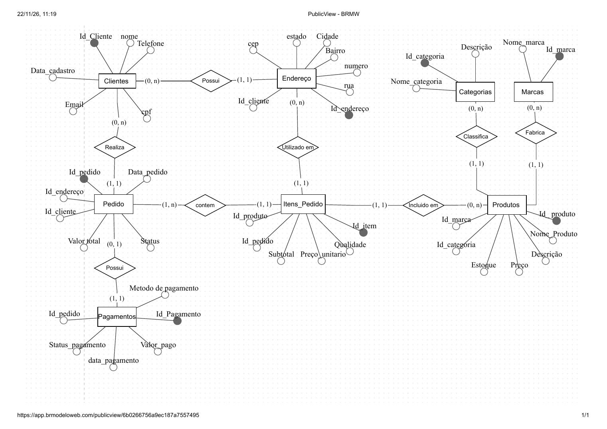

# Banco de dados e publicação

O site funciona de duas formas, escolhidas automaticamente:

| Modo | Quando | O que acontece |
|---|---|---|
| **Servidor** | Publicado na Cloudflare (Workers) com o banco configurado | Contas, sessões e pedidos ficam no Neon (PostgreSQL). Finalizar pedido exige login. |
| **Local** | Aberto pelo arquivo ou pelo Live Server | Como antes: conta e carrinho só no navegador; "Finalizar compra" apenas simula. |

A página pergunta a `/api/saude` se o banco responde; se não responder, usa o modo local.

## Como funciona

```text
navegador ──► /api/* (Cloudflare Worker) ──► Neon (PostgreSQL)
```

- O navegador nunca recebe a senha do banco. A string de conexão fica só na variável secreta `DATABASE_URL`.
- **Catálogo:** o ponto de partida é `public/js/dados.js` (e o `db/seed.sql`, gerado por `npm run seed`, copia esses produtos para o banco). Com a API ativa, cada visita busca `/api/produtos` e guarda uma cópia no navegador; **a página seguinte já usa os preços e dados do banco** (a cópia vale por 7 dias e é descartada se for inválida). Assim, para mudar um preço basta alterar a linha em `produto` no Neon. Sem API, vale o `dados.js`.
- **Pedidos:** o banco **define os preços**; valores enviados pelo navegador são ignorados.
- **Carrinho da conta:** ao entrar, o carrinho do navegador e o da conta se juntam (maior quantidade de cada produto); as mudanças vão ao banco. Ao sair da conta, o carrinho deste navegador é esvaziado, mas continua salvo na conta. Fazer o pedido esvazia o carrinho da conta.
- Ao alterar produtos em `dados.js`, rode `npm run seed` e execute o novo `db/seed.sql` no Neon.

## Modelagem

Modelo conceitual (BRModelo): [`docs/modelagem/modelagem-conceitual.pdf`](modelagem/modelagem-conceitual.pdf)



As relações do modelo estão todas no banco: Cliente 1:N Endereço, Cliente 1:N Pedido, Endereço 1:N Pedido, Categoria 1:N Produto, Marca 1:N Produto, Pedido 1:N Itens e Produto 1:N Itens, Pedido 1:0..1 Pagamento.

Como cada atributo do modelo aparece no banco (o banco usa nomes curtos, sem repetir o nome da tabela):

| Entidade (modelo) | Atributo do modelo | Coluna no banco |
|---|---|---|
| Clientes → `cliente` | Id_Cliente · nome · Email | `id_cliente` · `nome` · `email` |
| | Data_cadastro | `criado_em` |
| | Telefone · cpf | `telefone` · `cpf` (existem, mas o site **não coleta**: são dados pessoais desnecessários numa demonstração) |
| | — (acréscimo para o login) | `senha_hash` |
| Endereço → `endereco` | Id_endereço · Id_cliente · cep · numero · Bairro · Cidade | `id_endereco` · `id_cliente` · `cep` · `numero` · `bairro` · `cidade` |
| | rua · estado | `logradouro` · `uf` (sigla de 2 letras) |
| | — | `complemento` (acréscimo) |
| Categorias → `categoria` | Id_categoria · Nome_categoria · Descrição | `id_categoria` · `nome` · `descricao` |
| Marcas → `marca` | Id_marca · Nome_marca | `id_marca` · `nome` |
| Produtos → `produto` | Id_produto · Nome_Produto · Preço · Estoque · Id_marca · Id_categoria | `id_produto` · `nome` · `preco` · `estoque` · `id_marca` · `id_categoria` |
| | Descrição | `descricao` (existe, ainda sem preenchimento: o site monta o texto no navegador) |
| | — | `slug`, `plataformas`, `preco_antigo`, `etiqueta`, `imagem`, `tipo`, `ativo` (acréscimos do site) |
| Pedido → `pedido` | Id_pedido · Id_cliente · Id_endereço · Status | `id_pedido` · `id_cliente` · `id_endereco` · `status` |
| | Data_pedido · Valor total | `criado_em` · `total` |
| Itens_Pedido → `item_pedido` | Id_item · Id_pedido · Id_produto · Preço_unitario · Subtotal | `id_item` · `id_pedido` · `id_produto` · `preco_unitario` · `subtotal` |
| | "Qualidade" (provável erro de digitação de *Quantidade*) | `quantidade` |
| Pagamentos → `pagamento` | Id_Pagamento · Id_pedido · Metodo de pagamento | `id_pagamento` · `id_pedido` · `metodo` |
| | Status_pagamento · Valor_pago · data_pagamento | `status` · `valor` · `data_pagamento` |

Tabelas de apoio que não fazem parte do modelo conceitual: `sessao` (login), `carrinho_item` (carrinho da conta) e `tentativa_login` (limite de tentativas).

**Estoque:** cada produto novo começa com 100 unidades (valor definido no seed, ajuste como quiser). O pedido baixa o estoque e é recusado se não houver unidades; a coluna nunca fica negativa. Reexecutar o `seed.sql` não altera o estoque existente.

## Passo a passo

### 1. Neon

1. (Recomendado) No Neon, crie um **branch** do banco atual para testar sem mexer nos dados do seu colega. **Atenção:** o `seed.sql` grava os produtos com `id_produto` de 1 a 36 e, se já existirem produtos com esses números, os dados deles são **substituídos**.
2. Abra o **SQL Editor** e execute, nesta ordem, o conteúdo de `db/schema.sql` e depois `db/seed.sql`. Ambos podem ser executados mais de uma vez. Para demonstrar o banco, execute também `db/exemplos.sql` (4 clientes fictícios, endereços e 3 pedidos) e depois `db/consultas.sql` (5 consultas SELECT). Não rode `exemplos.sql` no banco de produção se não quiser clientes de teste.
3. Copie a **connection string** (Connection details → formato `postgresql://…`).

O `schema.sql` cria o que falta e acrescenta as colunas que o site usa nas tabelas que já existem, sem apagar nada. Se aparecer erro sobre coluna obrigatória (`NOT NULL`) em `cliente`, `produto` ou outra tabela, significa que o seu colega criou uma coluna que o site não preenche: torne-a opcional (`ALTER TABLE tabela ALTER COLUMN coluna DROP NOT NULL;`) ou ajuste o código.

### 2. Cloudflare Workers

O projeto já tem o `wrangler.jsonc`: ele publica a pasta `public/` como arquivos estáticos e envia só as rotas `/api/*` ao Worker (`worker/index.js`). O nome do Worker é `katchau`, o mesmo do endereço `katchau.jpsn-dev.workers.dev`.

1. No Worker `katchau` (Workers & Pages), confira em **Settings → Build** que o repositório está conectado, o *Build command* está em branco e o *Deploy command* é `npx wrangler deploy` (padrão). As dependências do `package.json` são instaladas no deploy.
2. Em **Settings → Variables and Secrets**, adicione `DATABASE_URL` como **Secret**, com a connection string do Neon.
3. Faça um novo deploy (um push na `main` já dispara) e abra `https://katchau.jpsn-dev.workers.dev/api/saude`. O esperado é `{"ok":true,"banco":true}`; se vier `Banco de dados não configurado`, falta o passo 2.
4. Para conferir tudo de ponta a ponta (banco, cadastro, carrinho, pedido), rode no seu computador:
   ```bash
   node scripts/verificar-api.cjs https://katchau.jpsn-dev.workers.dev
   ```
   Ele cria uma conta e um pedido de teste (o próprio script mostra como apagá-los depois).

Os nomes dos menus da Cloudflare podem mudar com o tempo; a ideia é sempre: deploy com o `wrangler.jsonc` e variável secreta `DATABASE_URL`.

### 3. Rodar na sua máquina com a API

```bash
npm install
cp .dev.vars.example .dev.vars    # edite com a sua connection string
npm run dev                        # abre em http://localhost:8787
```

`.dev.vars` está no `.gitignore` e nunca deve ser enviado ao GitHub.

## API

| Rota | Função |
|---|---|
| `GET /api/saude` | Confere a conexão com o banco |
| `GET /api/produtos` | Produtos do banco |
| `POST /api/cadastro` · `POST /api/login` · `POST /api/logout` · `GET /api/sessao` | Conta e sessão |
| `GET /api/carrinho` · `PUT /api/carrinho` | Carrinho da conta (exigem login) |
| `GET /api/enderecos` | Endereços usados em pedidos anteriores (exige login) |
| `POST /api/perfil` · `POST /api/senha` | Trocar nome e senha (exigem login) |
| `GET /api/pedidos` · `POST /api/pedidos` | Histórico e criação de pedidos (exigem login) |

Segurança: consultas sempre parametrizadas; senha com PBKDF2-SHA256 (100 mil iterações, limite do Workers) e sal aleatório; sessão em cookie `HttpOnly` + `SameSite=Lax` (o banco guarda só o hash do token); verificação de `Origin` nas requisições que alteram dados; mensagem única para e-mail inexistente e senha errada; **limite de 5 falhas por e-mail e 30 por endereço IP a cada 15 minutos**; trocar a senha encerra as outras sessões; pedido gravado de forma atômica (endereço, pedido, itens e pagamento juntos), reaproveitando um endereço idêntico já salvo.

Limites conhecidos: não existe recuperação de senha (exigiria envio de e-mail) e o pagamento é apenas registrado como `pendente`: nenhuma cobrança real existe.

## Testes

```bash
# precisa de um PostgreSQL local (não usa o Neon)
export PGHOST=localhost PGUSER=postgres PGDATABASE=katchau_teste
psql -f db/schema.sql && psql -f db/seed.sql
npm test
```

Os testes executam a API de verdade contra o banco local: validações, cadastro, login, sessão, pedidos e recusas.
